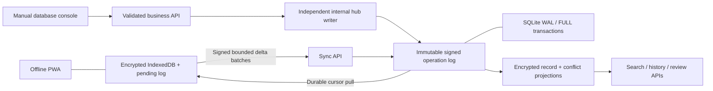

# Smriva — Last-mile records. Continuous care.

**[Documentation](docs/README.md) · [Requirements and evidence](docs/REQUIREMENTS_MAP.md) · [API reference](docs/API.md) · [Security](docs/SECURITY.md) · [Judge walkthrough](docs/DEMO_SCRIPT.md)**

Smriva brings village-school and community-health records into one consented child record. People work independently, and their changes cross weak connections without silently discarding a competing account.

Stage 2 adds a complete village-hub business backend, manually editable database console, controlled enrollment, encrypted query projections, versioned changes and audit history. The orbit mark remains, with restrained green accents, a charcoal dark theme and an off-white light theme. The system uses conventional, testable distributed-systems and cryptographic techniques.

The standard dashboard keeps the compact tables and familiar navigation. Optional **Easy mode** uses plain language, larger controls and a simpler home screen for everyday entry. The preference stays on this device and does not change roles, records or synchronization. Visible roles use friendly labels: Community member, Teacher, Health worker and Administrator; the API's existing role values remain compatible.

The earlier project is preserved separately in `SetuSync-original-before-Smriva.zip`. The Smriva rename preserves existing local records and recovery workspaces.

The interface puts everyday work first: compact registers, plain instructions, quiet section dividers and clear saving status. The public introduction shows an explicitly synthetic attendance example. Easy mode presents six readable task links, while the learning library keeps short cards, directly clickable government images and expandable details. English, Hindi and Punjabi, keyboard controls and offline workflows remain available. The earlier appearance is preserved in `Smriva-before-design-refinement.zip`; [design notes](docs/DESIGN_NOTES.md) explain the visual choices.

## Choose your dashboard

The **Easy mode** switch sits beside the page name, above the dashboard. It starts off, keeping the original compact dashboard. Switch it on for:

- Six large task links for children, attendance, marks, health visits and learning.
- Plain-language navigation, larger text, 44-pixel controls and visible keyboard focus.
- Page-specific steps and a link back to the activities.
- Separate explanations for records saved on this device and records copied to the village hub.
- Technical history and extra tools available in expandable sections.

Both views use the same records, forms and permissions. Switching modes preserves unfinished form values and saved encrypted score drafts. The choice persists across reloads and offline PIN unlock in this browser. Turn Easy mode off at any time to return to the original dashboard. This is a presentation preference; it does not grant additional access or claim accessibility certification.

## Choose your language

The top of the workspace, unlock and recovery screens has three visible buttons: **English · हिन्दी · ਪੰਜਾਬੀ**. The selected language changes navigation, data-entry forms, status/help messages, Easy mode, government-resource descriptions and all four original lessons/quizzes. Script-specific system fonts, generous line spacing and wrapping keep Hindi and Punjabi readable on phones. Both scripts use left-to-right layout.

The language choice stays on this browser and works offline. Switching preserves unfinished forms, PIN entry, selected children and existing records. Names, notes, record identifiers, API values and CSV column names retain their original text. Government artwork, raw technical logs and the public source/about documentation retain their source language. See [language coverage and maintenance](docs/LANGUAGES.md).

## Run

Requires **Node 24 or later**. No external account, cloud database or sponsor API key is needed for the synthetic demo.

```sh
npm ci
npm run build
npm start
```

Open **http://localhost:3001** for the public introduction, or **http://localhost:3001/app/today** for the workspace. Enter a name, select Community member or Administrator, and create a 6–12 digit local PIN. Initial enrollment needs the hub; the PIN subsequently unlocks local encrypted records offline. Administrator can issue invitations; Community member can use both record domains and review conflicts.

Windows launcher, including the runtime detected in this workspace:

```powershell
powershell -ExecutionPolicy Bypass -File .\start-smriva.ps1
```

Existing PINs, databases and encrypted backups remain readable. A present `data/kuka.sqlite` is migrated in place; a new installation retains the compatible `data/setusync.sqlite` path. No accepted operations are renamed or rewritten during the migration.

### Synthetic patient demo

The Doctor’s register includes 12 fictional patients with realistic names, visit dates, times and varied consultation purposes. Every sample visit is labeled “Fictional demo patient.” These entries remain separate from the 24 students and classroom attendance.

Demo hubs add these visits on startup, including existing demo databases. Repeated starts preserve existing records and do not duplicate visits. Set `SEED_DEMO_DATA=false` to skip seeding; controlled production mode also skips it. The Vercel deployment is an in-memory demonstration: server records and sessions can reset when its function restarts. Use the local SQLite hub for durable server storage.

### Forgotten device PIN

There is no default PIN or PIN-reset backdoor. On the unlock screen, **Forgot PIN?** opens recovery without clearing local records:

- With the saved recovery code, choose a new PIN. Recovery restores synchronized hub records into a separate encrypted workspace and revokes the previous identity.
- In synthetic demo mode, **Start a separate demo workspace** allows new enrollment and a new PIN without needing the old PIN or recovery code. It does not revoke the old identity.
- The original encrypted database remains on this browser. **Saved workspace** on the unlock screen lets you select it if you later remember its PIN. Unsynchronized entries and drafts remain there; a separately password-encrypted backup can also be imported through Settings.

Do not clear site data to fix a forgotten PIN. The browser stores only workspace names and the active selection outside the encrypted databases.

Development: `npm run dev` → http://localhost:5173, with API proxy to port 3001. Use the **production build** for service-worker/offline testing. Docker: `docker compose up --build` (configuration supplied; Docker was not available for execution in this environment).

### Open on phones, tablets and other computers

Use the same hub's **HTTPS address** on each device. A localhost link refers to the device opening it. Only the hub needs Node; client devices use a browser.

- Windows: `start-smriva.cmd`, or `start-smriva.cmd -Lan` for network listening.
- macOS/Linux: `sh ./start-smriva.sh`, or add `--lan` for network listening.
- Any supported hub OS: `npm run start:lan` prints local-network addresses.
- Native HTTPS accepts a trusted PEM certificate/key pair or Windows PFX. An optional Caddy Docker overlay supplies automatic HTTPS for a configured public hostname.

See [device setup and verification](docs/DEVICE_SUPPORT.md) for certificate settings, Docker commands and the browser test matrix. HTTP Wi-Fi addresses cannot provide browser encryption or offline installation; the app explains this before enrollment. No public hostname has been provisioned automatically.

## Enter records manually

Open **Hub database → Database → New database record**. This is a real server database console:

- Create a child with explicit consent, guardian details, class and village.
- Search and paginate records loaded from SQLite.
- Edit against the record’s causal version; stale changes are rejected for review.
- Archive/restore with tombstones, preserving the original history.
- Inspect actual record/operation/conflict counts, schema version and SQLite storage.
- Provision role-bound invitations, inspect audit events, manage devices, and annotate quarantined operations.

“Saved at hub” means the server committed the transaction. A subsequent pull brings those same signed operations into the offline workspace. The Children, Classroom and Health records pages instead save **locally first** and synchronize later. The interface keeps these guarantees distinct.

To start a separate, empty demonstration database without deleting existing data:

```powershell
$env:DATABASE_PATH = './data/my-village.sqlite'
$env:SEED_DEMO_DATA = 'false'
npm start
```

Use the forms or validated API to enter data. Directly editing materialized SQL tables bypasses the operation log and is not supported.

## Controlled enrollment outside judge mode

```sh
npm run setup:production
npm start
```

The setup command creates an ignored `.env`, generates private secrets without printing them, preserves an existing hub encryption key when present, disables open judge enrollment, and disables synthetic seeding. It refuses to overwrite an existing `.env`.

Open `.env` privately and use `BOOTSTRAP_TOKEN` once in the enrollment-code field to enroll the first Hub Admin. The role is assigned by the server. The administrator then issues one-time, expiring Teacher/Health Worker/Reviewer/Admin invitations through the Enrollment tab. A client cannot promote itself by changing the requested role. Bootstrap closes permanently after the first administrator exists.

Local server operators can also issue an invitation:

```sh
npm run db:invite -- --role Teacher --hours 24
```

That operator command intentionally displays the newly issued code once in the local terminal; do not share terminal logs. API logs never print device tokens or enrollment secrets.

Use HTTPS outside localhost and complete privacy/clinical-safety reviews before using real records. The enrolled **school workspace** is the present read boundary; sync/bundles are not per-field clinical read ACLs. Controlled enrollment is implemented, but no external SSO/passwordless provider is claimed.

## Data-entry workflows

- **Attendance:** P/A/L/E on a focused row, arrow navigation, search/class/date filters and batch entry. Default bulk entry fills unmarked children; changing existing marks requires selecting those children. Conflicts stay in the inbox.
- **Assessments:** Enter or blur saves a valid score, including zero. Enter advances to the next child. Invalid/incomplete scores survive navigation and offline reloads as encrypted drafts, and are included in encrypted backups.
- **Children:** repeat registration preserves class/village. CSV import validates and previews up to 100 rows, flags possible matches without automatically merging identities, and commits included records atomically. CSV export is available.
- **Health:** consent-linked visits, vaccinations, weight/height/MUAC measurements with bounded numeric/date validation and retained event history. No diagnosis, dosage recommendation or vaccine schedule inference.
- **Learning:** four illustrated offline lessons/quizzes with durable progress, plus eight government-programme cards with official images, source credits, search and category filters. Programme previews work offline; linked government websites need internet. See [library sources and maintenance](docs/LEARNING_LIBRARY.md).
- **Navigation:** Ctrl+K local search, Ctrl+Enter form submit, readable light/dark themes, compact tables and responsive controls.

## Backend architecture



The shared core contains runtime schemas, monotonic hybrid logical clocks, causal ancestry, multi-value registers, observed-remove tags, append-only event sets, unique counter deltas, batching and canonical digests. **Causality determines concurrency; clocks do not settle conflicting school or health values.**

The hub uses Express and Node’s built-in SQLite. Unique operation IDs, authenticated signatures, school membership, role write checks and immutable ID checks cover accepted and quarantined operations. WAL and `synchronous=FULL` establish the acknowledgement boundary. Received operations and the local cursor commit together.

Manual writes allocate a distinct internal signing writer for each enrolled source device, so online commands cannot collide with an offline phone’s counter. An operation transaction also commits encrypted materializations, audit details and an idempotency receipt. Exact request replay is recognized before stale-record preconditions. Existing critical conflicts cannot be overwritten by normal updates.

New indexed tables include `materialized_records`, `conflict_projection`, `command_receipts`, and role-bound `invitations`; the existing device/audit/quarantine tables are upgraded additively. `PRAGMA user_version` tracks migrations. Record bodies, conflicts, receipts, audit details and signing secrets are encrypted. IDs, role/device membership and other indexing metadata remain visible.

**[All business and synchronization routes](docs/API.md)** include children, attendance, assessments, visits, growth, vaccinations, lesson progress, conflict resolution, sessions, enrollment, devices, audit, quarantine, bundles and database diagnostics. Validation, authorization and concurrency errors return structured JSON with request IDs.

## Recovery and operations

```sh
npm run db:inspect
npm run db:backup
# Optional explicit target; existing files are never overwritten:
npm run db:backup -- --out ./backups/pre-upgrade.sqlite
```

The SQLite online backup API creates a consistent file snapshot. The backup command opens the source read-only and does not run migrations first. Keep the corresponding hub encryption key separately; the database cannot be decrypted without it. Never commit `.env`, `data/`, `backups/`, device exports or credentials.

Device recovery atomically enrolls a replacement and revokes the previous device. The last active Hub Admin is protected from revocation. Revoked identities’ newly submitted work is retained in quarantine. Records never synchronized and never exported cannot be recovered after device loss.

The Settings page exports a separately password-encrypted operation/draft backup. Signed original operations can be restored to another authorized device and forwarded without copying login credentials. Both `kuka-backup` and `setusync-backup` files are accepted; new exports use `smriva-backup`. Legacy encryption AAD, school IDs, bundle formats, browser preference keys and IndexedDB names are deliberately retained for compatibility.

On the destination device, use **Settings → Restore from another device** and enter the original **backup passphrase**, which can differ from its device PIN. Older short passphrases and UTF-8/UTF-16 JSON copies are supported. See [backup transfer, fixes and verification](docs/BACKUP_RESTORE.md) for the workflow and error recovery.

## Verify

Verification passed: **266 automated tests, 29 regression browser scenarios, 20 device-compatibility scenarios, and nine recorded chaos runs**. Eight library accessibility scans cover desktop/mobile, standard/Easy mode and light/dark themes; eight additional phone scans cover Hindi/Punjabi in both modes/themes. All 13 library images loaded after an offline reload. Language checks preserve role values, unfinished health entries and offline Punjabi quiz progress. The production build and 21 bundled-source checks passed. A backup/migration check confirmed that the existing operation ciphertext was preserved. Coverage also checks same-browser concurrent tabs, stale-field conflicts, lock races, private indexing rules, server-rendered public pages, real HTTP 404s, compression, keyboard switching, phone layout, unfinished forms and offline draft preservation.

The [merge and conflict audit](docs/MERGE_AUDIT.md) records the explicit-review safeguards, independent-field merges, late/offline resolutions, interrupted transfers and backup validation. Ordinary edits cannot absorb an observed conflict. Child forms preserve the context they displayed and write only changed fields; sync sends causal parents before descendants. Unsafe review bypasses, missing dependencies and cycles are rejected without acknowledging their pending changes. The refreshed nine simulations retained all 2,160 operation instances with no duplicate effects; this is evidence for those runs, not a universal zero-loss proof.

```sh
npm test
npm run chaos
npm run data:verify
npm run build
npx playwright install chromium
npm run test:e2e
```

Browser tests launch an isolated hub/database on port 3002 and do not modify the demonstration database. For installed Chrome on Windows:

```powershell
$env:CHROME_PATH = 'C:\Program Files\Google\Chrome\Application\chrome.exe'
npm run test:e2e
```

The suite covers offline reload, sync interruptions/replay, convergence, incompatible edits and resolutions, deletion/restore, encryption and wrong passwords, backup drafts, storage errors, authorization, production bootstrap/invitations, real manual APIs, optimistic versions, separate hub/client counters, additive migrations, recovery rollback, admin protection and quarantine identity collisions.

Browser scenarios verify independent-device conflicts, mobile recovery, offline lessons, keyboard/bulk attendance, restored score drafts, CSV/repeat registration/search/themes, and manual hub CRUD/invitation/audit followed by local synchronization. Screenshots are in `docs/`.

## Measured evidence

`npm run chaos` records actual results in [docs/benchmark-results.json](docs/benchmark-results.json), also available to the lab. It uses 3/8/16 devices, three fixed seeds, 240 operations per run, 60% simulated packet loss and duplicate/reordered delivery, then an explicit eventual reconnect. This is an in-process simulator; its CPU duration is not real mobile-network latency. The Sync Center separately measures actual HTTP JSON payload bytes and end-to-end request duration.

Zero-loss claims apply only to the recorded tested runs: every accepted valid operation remains in the final log, with incompatible meanings exposed. No universal guarantee, production adoption or clinical correctness is implied.

## Sources

All demo child and care records are synthetic. Four original text lessons/quizzes and original artwork are CC BY 4.0; system fonts need no network download. India education context is a verified World Bank/UNESCO UIS snapshot with individual observation years, retrieval date and source links, separate from school-level records. No unknown values are replaced by zero; gross enrollment ratios can exceed 100%.

[Source manifest](packages/content/sources.json) records authorship, original URLs, licenses, byte sizes, SHA-256 and offline permission. `npm run data:fetch` refreshes national metadata/observations and regenerates the manifest; builds run attribution/checksum validation. Eight unchanged programme images from the Ministry of Education and National Health Mission are bundled under their respective reproduction policies, with prominent attribution and individual image/policy links. These government images are separate from Smriva's CC BY artwork. `npm run library:fetch` refreshes the curated images and manifests. Government websites, PhET and OpenStax remain online-only links. The theme references [Primer product patterns](https://primer.style/product/getting-started/), with an original Smriva identity.

## Environment

| Variable               | Meaning                                                                         |
| ---------------------- | ------------------------------------------------------------------------------- |
| `PORT`, `HOST`         | Default 3001 / 127.0.0.1; Docker binds 0.0.0.0                                  |
| `DATABASE_PATH`        | Optional; existing legacy database is preferred, otherwise data/setusync.sqlite |
| `DEMO_JUDGE_MODE`      | Defaults true for a self-contained synthetic judge demo                         |
| `SEED_DEMO_DATA`       | false creates no synthetic records; existing data is never cleared              |
| `DEMO_ENROLLMENT_CODE` | Demo-only code, default setusync-demo-2026; legacy demo code remains compatible |
| `HUB_ENCRYPTION_KEY`   | 32-byte hex key, required outside demo mode                                     |
| `BOOTSTRAP_TOKEN`      | Private first-admin code; generated by setup:production, minimum 24 characters  |
| `ALLOWED_ORIGIN`       | Development CORS origin, default http://localhost:5173                          |

## Boundaries

This is a runnable stage-2 hackathon system, not a certified clinical deployment. External SSO, fine-grained clinical read ACLs, district federation, Merkle repair, WHO z-scores, ANC/prescription decision support and external integrations are not implemented. A short PIN remains susceptible to offline guessing; unlocked workspaces cannot resist malicious script. Large deployments need causal indexing/compaction instead of whole-log projection rebuilds. HTTPS, key management and an organization-specific retention/access review remain deployment work. The n8n file is an inactive template only. Built at BIOS V2; no affiliation, endorsement, award or deployment claim.
